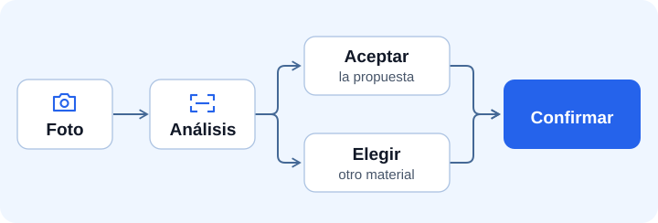
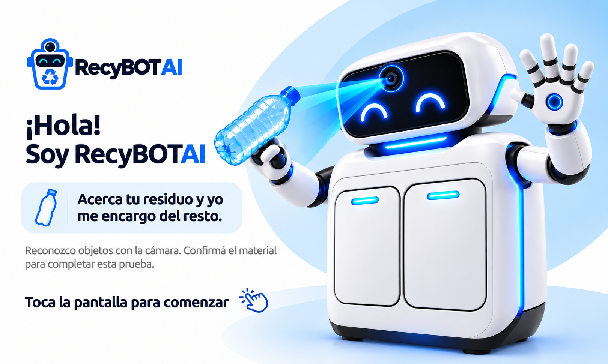
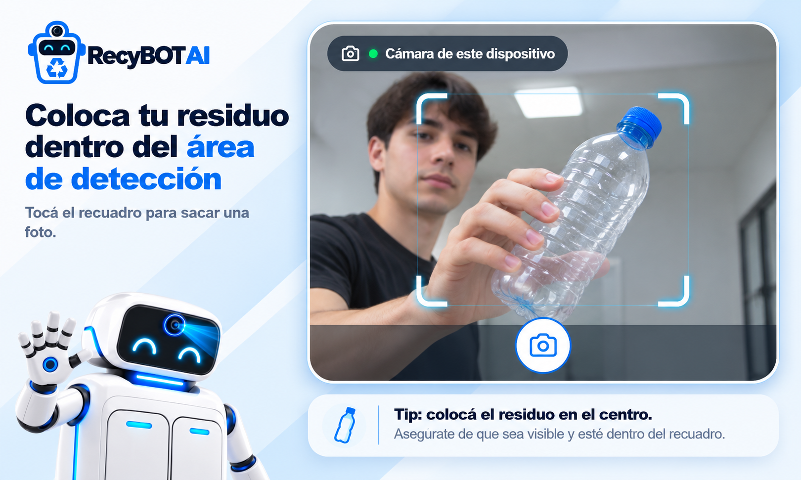
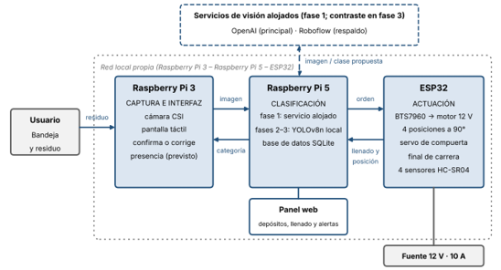

<h1 align="center">Una forma más inteligente de separar los residuos.</h1>

  RecyBOT AI es la interfaz táctil de un basurero inteligente que utiliza
  inteligencia artificial para identificar residuos y facilitar su
  correcta clasificación.

  El usuario presenta un residuo, la IA identifica su material y
  permite confirmar o corregir el resultado antes de depositarlo.

  

---

<h3 align="center">Tecnologías utilizadas</h3>

  El proyecto combina tecnologías web modernas con inteligencia artificial para ofrecer una interfaz interactiva, rápida y sencilla de utilizar.

  

 

<h2 align="center">De la foto al material</h2>

  

 

  
  &nbsp;<strong>01. Captura el residuo</strong>

Todo comienza con una fotografía. Desde la pantalla de bienvenida, el usuario accede a la cámara y captura el residuo que desea clasificar.

 

  
  &nbsp;<strong>02. La inteligencia artificial hace su parte</strong>

RecyBOT AI analiza la imagen y propone una clasificación entre cuatro categorías: **Plástico, Papel / Cartón, Metal y Otros**. El sistema presenta el resultado de forma clara, facilitando la identificación del material sin necesidad de conocimientos técnicos.

 

  
  &nbsp;<strong>03. El usuario tiene la última palabra</strong>

La inteligencia artificial propone, pero la decisión final es humana. El usuario puede **confirmar el resultado o seleccionar otro material** cuando sea necesario. Una vez confirmado, la interfaz muestra la clasificación final y permite iniciar un nuevo proceso.

 

<h2 align="center">La interfaz</h2>

| Bienvenida | Captura en el dispositivo |
| :---: | :---: |
|  |  |
| Un toque en la pantalla inicia el recorrido. | El marco indica dónde colocar el objeto. |

 

<h2 align="center">Qué hace la inteligencia artificial</h2>

RecyBOT AI utiliza YOLOv8 de Ultralytics para analizar fotografías, detectar residuos e identificar el tipo de material al que pertenecen: Plástico, Papel / Cartón, Metal u Otros.

La IA propone una clasificación que el usuario puede confirmar o corregir. Estas correcciones se almacenan para futuros entrenamientos, ayudando a mejorar progresivamente la precisión del sistema.

 

<h2 align="center">Arquitectura</h2>

  

La **Raspberry Pi 3** captura la imagen y muestra en la pantalla táctil la categoría que el usuario puede confirmar o corregir. La **Raspberry Pi 5** clasifica el residuo con YOLOv8n. El esquema prevé que un **ESP32** accione el mecanismo de separación y reporte la posición y el nivel de llenado. El **panel web** mostraría el estado de los depósitos y las alertas.